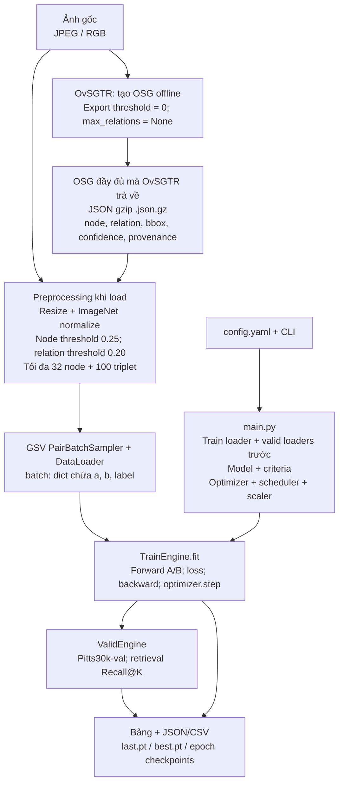
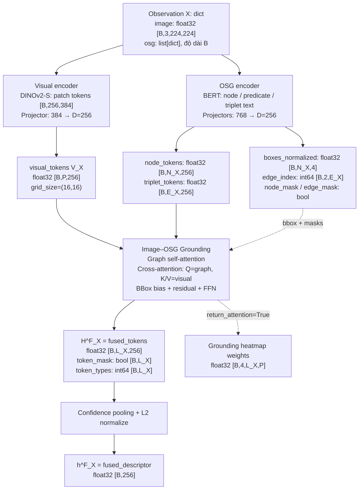
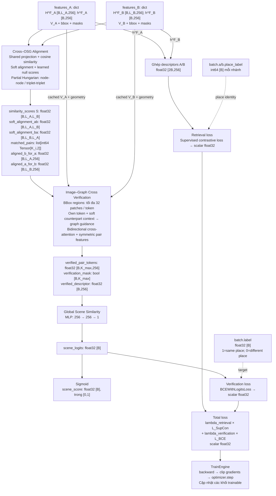
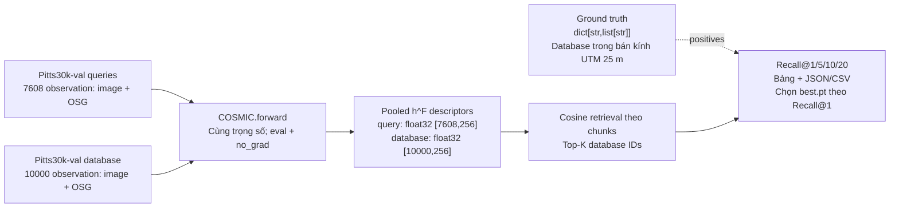

# COSMIC: pipeline hiện tại

Sơ đồ đối chiếu với `config.yaml` và code hiện tại. Tensor số thực bên dưới
dùng `torch.float32` theo cấu hình `training.precision: fp32`.

## Ký hiệu

- `B`: số cặp trong batch train. Ví dụ `B=8`: 4 positive + 4 negative,
  gồm 16 ảnh khác nhau, lấy từ 4 địa điểm với 4 ảnh/địa điểm.
- `D=256`: chiều embedding chung của visual, OSG và fusion.
- `P=256`: số patch của DINOv2-S ở ảnh `224×224`, grid `16×16`.
- `N_X`, `E_X`: số node/triplet sau padding trong batch của nhánh `X`.
  Chúng là số lượng lớn nhất thực tế trong batch, với `N_X≤32`, `E_X≤100`.
- `L_X=N_X+E_X≤132`: số hàng token của nhánh `X`, gồm cả padding.
- `K_i`: số cặp token hard-matched của cặp ảnh thứ `i`;
  `K_max=max(K_i)` khi verification padding các cặp match.
- Đường liền: truyền dữ liệu/feature. Đường nét đứt: metadata, supervision
  hoặc đầu ra tùy chọn, với ý nghĩa ghi trên đường.

## Dữ liệu và điều phối



GSV dùng để train; Pitts30k-val dùng để chọn checkpoint; AmsterTime dành cho
test/comparison cuối cùng. Graph gốc được giữ nguyên trên đĩa.

## Encode một observation: dùng cho cả A, B, query và database

`X` có thể là `A` hoặc `B`. Cùng một đối tượng COSMIC thực hiện
`model(batch['a'])` và `model(batch['b'])`, nên hai nhánh dùng chung trọng số.



`H^F` là nhiều token, mỗi token là một vector 256 chiều. `h^F` là một vector
pooled 256 chiều cho mỗi ảnh. Padding có mask `False`; graph rỗng tạo descriptor
zero và được loại khỏi retrieval loss bằng `graph_mask`.

DINO đã có ViT encoder. Khi đổi sang ResNet, visual encoder dùng ResNet →
projector → spatial Transformer; số patch `P` phụ thuộc stage và kích thước ảnh.

OSG encoder còn trả về predicate tokens và các summary descriptor DCE/GCE/graph.
Luồng grounding hiện dùng node tokens và triplet tokens. Bbox vẫn được dùng cho
grounding và verification khi `osg_encoder.use_bbox_embedding: false`.

## So sánh A/B và hai loss



`matched_pairs` chứa chỉ số hàng token của `H^F_A/H^F_B`; đây là cặp token,
không phải nhãn positive/negative của cặp ảnh. Hard assignment không khả vi;
soft context và similarity scores giữ đường gradient tới alignment.

Hai loss mặc định có trọng số bằng 1. Retrieval loss dùng place identity của
tất cả `2B` ảnh trong batch; BCE dùng nhãn nhị phân của `B` cặp. BCE nhận logits
trước sigmoid. BERT/DINO đang frozen; projectors, grounding và các khối so sánh
nhận gradient. Các summary heads phụ không được dùng trong hai loss hiện tại.

Nếu không có hard match, verification trả descriptor zero; scoring head vẫn
tính logits và BCE cho cặp ảnh đó. Score sau sigmoid là đầu ra của model;
quyết định nhị phân dùng ngưỡng đã chọn khi đánh giá.

## Validation và retrieval



Validation retrieval hiện dùng trực tiếp `h^F`, không chạy alignment,
verification và scoring cho mọi cặp query/database. Số observation trong một
batch valid độc lập với số cặp trong batch train.

## Đối chiếu output và kiểu dữ liệu

| Output | Kiểu / shape | Vai trò |
| --- | --- | --- |
| `features['visual']['visual_tokens']` | float32 `[B,P,256]` | Visual patch tokens |
| `features['osg']['node_tokens']` | float32 `[B,N_X,256]` | Node embeddings |
| `features['osg']['triplet_tokens']` | float32 `[B,E_X,256]` | Triplet embeddings |
| `features['osg']['boxes_normalized']` | float32 `[B,N_X,4]` | Bbox xyxy chuẩn hóa |
| `features['osg']['edge_index']` | int64 `[B,2,E_X]` | Node đầu mút của triplet |
| `features['grounding']['fused_tokens']` | float32 `[B,L_X,256]` | `H^F_X` |
| `features['grounding']['fused_descriptor']` | float32 `[B,256]` | `h^F_X` cho retrieval |
| `features['grounding']['token_mask']` | bool `[B,L_X]` | Token thật / padding |
| `features['grounding']['token_types']` | int64 `[B,L_X]` | 0=node, 1=triplet, -1=padding |
| `alignment['matched_pairs']` | list[int64 Tensor`[K_i,2]`] | Cặp token hard-matched |
| `verification['verified_descriptor']` | float32 `[B,256]` | Embedding chung của cặp ảnh |
| `scene['scene_logits']` | float32 `[B]` | Input của BCE |
| `scene['scene_score']` | float32 `[B]` | Score sau sigmoid |
| `losses['loss']` | float32 scalar, shape `[]` | Tổng loss dùng backward |

API train hiện tại:

```python
features_a = model(batch['a'])
features_b = model(batch['b'])
alignment = model.align(features_a, features_b, compute_hard=True)
verification = model.verify(features_a, features_b, alignment)
scene = model.score(verification)
losses = criteria(features_a, features_b, batch, scene_logits=scene['scene_logits'])
losses['loss'].backward()
```

File chính: `main.py`, `registry.py`, `data/gsv_cities_loader.py`,
`data/pitts30k_loader.py`, `model/model.py`, `model/criteria.py`,
`train_engine.py`, `valid_engine.py`.
